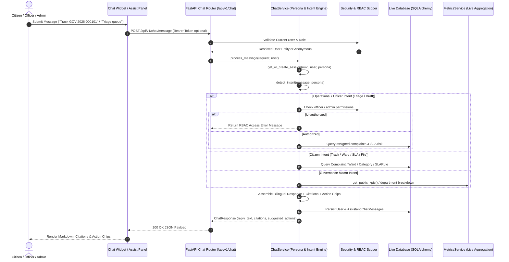

# AI-GovInsight: Role-Aware Conversational Assistant Architecture (Milestone C1)

## 1. Executive Summary

The **AI-GovInsight Conversational Engine ("Namma Assistant" / நம்ம உதவி உதவியாளர்)** is a role-aware civic intelligence system built for the Government of Tamil Nadu and Greater Chennai Corporation (GCC). It bridges citizens, field nodal officers, and state administrators into a unified conversational interface grounded directly in the live municipal grievance database and statutory citizen service charters.

Unlike generic LLM wrappers, the AI-GovInsight chatbot architecture enforces:
1. **Strict Entity Grounding**: All complaint statuses, SLA deadlines, officer rosters, and municipal performance metrics are retrieved directly from the live PostgreSQL/SQLite database—eliminating hallucinations.
2. **Role-Based Persona Scoping**: Dynamic RBAC resolution seamlessly adapts capabilities between anonymous citizens, authenticated citizens, field nodal officers, and state administrators.
3. **Structured Citation Contracts**: Every answer delivers verified citations (`complaint`, `ward`, `sla_rule`, `analytics`) with deep links.
4. **Actionable Function Dispatching**: Answers provide interactive action chips (`navigate`, `quick_reply`, `fill_report`, `copy_draft`) and structured action proposals requiring explicit user confirmation.
5. **Bilingual Native Experience**: Native support for English and Tamil (தமிழ்), with Tamil script rendering and contextual action chips.

---

## 2. System Architecture & Flow



---

## 3. The Three Personas & Role Boundaries

| Persona Code | Display Name | Target Role | Primary Capabilities | Guardrails |
| :--- | :--- | :--- | :--- | :--- |
| `citizen` | **Namma Civic Assistant**<br>(`நம்ம உதவி உதவியாளர்`) | Anonymous visitors, Registered Citizens | • Tracking complaints by reference no (`GOV-2026-XXXXXX`)<br>• Step-by-step reporting guide<br>• GCC Ward & Nodal Officer directory<br>• Citizen charter statutory SLA guidelines<br>• Adopt-a-Spot discovery & civic campaigns | Cannot access officer triage queues, private PII of other citizens, or administrative controls. |
| `officer` | **Nodal Copilot**<br>(`அலுவலர் துணை`) | Field Nodal Officers, Ward Engineers | • Live triage of assigned ward complaints<br>• Approaching SLA breach prioritization<br>• Drafting official resolution inspection notes adhering to TN Municipal Standards<br>• Direct deep link into `/officer` workbench | Accessible only by `UserRole.OFFICER` and administrators. Enforces tenant/ward assignment scoping. |
| `gov_admin` | **Governance Oracle**<br>(`நிர்வாக நுண்ணறிவு`) | Department Admins, State Admins | • Cross-ward SLA breach telemetry<br>• Live departmental resolution rates<br>• Monsoon and seasonal campaign oversight<br>• City-wide bottleneck analytics | Requires `UserRole.DEPT_ADMIN` or `UserRole.GOV_ADMIN`. Queries live aggregates via `MetricsService`. |

---

## 4. Security & RBAC Guardrails

1. **Persona Resolution Algorithm**:
   ```python
   def _resolve_persona(user: Optional[User]) -> str:
       if not user:
           return "citizen"
       if user.role == UserRole.OFFICER:
           return "officer"
       if user.role in (UserRole.DEPT_ADMIN, UserRole.GOV_ADMIN):
           return "gov_admin"
       return "citizen"
   ```

2. **Session Ownership & Protection**:
   - Every `ChatSession` is uniquely identified by a UUID.
   - If created by an authenticated user, the session is bound to `user_id`.
   - Only the session owner or a user with `gov_admin` privileges can view or delete the session thread (`DELETE /api/v1/chat/sessions/{uuid}`).
   - Cross-user session deletion attempts by other citizens return `False` / `404 Not Found`.

3. **Operational Intent Protection**:
   - If an unauthorized citizen requests officer-only workflows (`officer_triage`, `draft_resolution`), the engine intercepts the intent and returns a clear authorization error notice without disclosing internal queues.

---

## 5. Live Entity Grounding & Anti-Hallucination

All conversational outputs are strictly derived from relational entities in the database:

1. **Complaint Tracking (`track_complaint`)**:
   - Extracts regex patterns: `(?:TN|GOV)-2026-\d+`.
   - Queries `Complaint` joined with `Department`, `Ward`, `assignments`, and `sla_deadline`.
   - Computes live SLA countdown: `(sla_deadline - datetime.utcnow())`.
   - Returns structured `CitationItem` pointing to `/issues/{id}`.

2. **GCC Ward Directory (`ward_info`)**:
   - Queries `Ward` table by `ward_number`.
   - Dynamically resolves assigned `User` where `User.ward_id == Ward.id and User.role == UserRole.OFFICER`.
   - Surfaces verified official contact phone, email, and GCC ward jurisdiction.

3. **Statutory SLA Standards (`sla_turnaround`)**:
   - Queries `ComplaintCategory` ordered by `sla_hours`.
   - Surfaces standard turnaround times (e.g. 12h for Garbage, 24h for Water Stagnation, 48h for Potholes).

4. **Macro Telemetry (`governance_kpi`)**:
   - Directly calls `MetricsService.get_public_kpis()`.
   - Dynamically computes total grievances, resolved count, resolution rate %, and active backlog—zero hardcoded mock data.

---

## 6. Bilingual Support & Formatting

The conversational engine provides first-class support for English and Tamil (`ta`):
- **Tamil Intent Keywords**: Handles native Tamil phrasing like `வணக்கம்` (greeting), `புகார் பதிவு` (file complaint), `நிலை` (track status), `அலுவலர்` (officer), `கால அவகாசம்` (SLA turnaround).
- **Tamil Action Chips**: Every interactive chip provides a `label_ta` property (e.g., `இப்போதே புகார் செய்`, `கண்காணிப்பு தளம்`, `அலுவலர் பலகைக்குச் செல்`).
- **Typography & Font Diacritics**: Frontend layouts render Tamil text with `.font-tamil` styling to prevent glyph clipping.

---

## 7. Data Contracts & Database Schema

### Database Models (`backend/app/models/entities.py`)

#### `ChatSession`
```python
class ChatSession(Base):
    __tablename__ = "chat_sessions"

    id = Column(Integer, primary_key=True, index=True)
    session_uuid = Column(String(36), unique=True, nullable=False, index=True)
    user_id = Column(Integer, ForeignKey("users.id"), nullable=True, index=True)
    persona = Column(String(50), default="citizen", nullable=False)
    language = Column(String(10), default="en", nullable=False)
    title = Column(String(255), default="New Conversation", nullable=False)
    context_metadata = Column(JSON, nullable=True)
    created_at = Column(DateTime, default=datetime.utcnow, nullable=False)
    updated_at = Column(DateTime, default=datetime.utcnow, nullable=False)

    user = relationship("User", back_populates="chat_sessions")
    messages = relationship("ChatMessage", back_populates="session", cascade="all, delete-orphan")
```

#### `ChatMessage`
```python
class ChatMessage(Base):
    __tablename__ = "chat_messages"

    id = Column(Integer, primary_key=True, index=True)
    session_id = Column(Integer, ForeignKey("chat_sessions.id"), nullable=False, index=True)
    role = Column(String(20), nullable=False)  # user, assistant, system
    content = Column(Text, nullable=False)
    language = Column(String(10), default="en", nullable=False)
    intent = Column(String(100), nullable=True)
    citations = Column(JSON, nullable=True)
    suggested_actions = Column(JSON, nullable=True)
    action_proposal = Column(JSON, nullable=True)
    tool_calls = Column(JSON, nullable=True)
    tool_results = Column(JSON, nullable=True)
    created_at = Column(DateTime, default=datetime.utcnow, nullable=False)

    session = relationship("ChatSession", back_populates="messages")
```

### REST API Endpoints

| Method | Endpoint | Description | Auth Required |
| :--- | :--- | :--- | :--- |
| `POST` | `/api/v1/chat/message` | Process query, return grounded reply, citations & chips | Optional (Visitor / Citizen / Officer) |
| `GET` | `/api/v1/chat/personas` | List supported personas, descriptions & sample prompts | Public |
| `GET` | `/api/v1/chat/sessions` | List active sessions for authenticated user | Required |
| `GET` | `/api/v1/chat/sessions/{uuid}` | Retrieve full message thread for session UUID | Owner / Gov Admin |
| `DELETE` | `/api/v1/chat/sessions/{uuid}` | Delete conversation thread | Owner / Gov Admin |

---

## 8. Verification & Test Suite

Milestone C1 test suite in [`tests/test_chat_architecture.py`](file:///Users/mk/Desktop/civic-2.0/tests/test_chat_architecture.py) verifies:
- `test_persona_capabilities`: 3 personas returned with bilingual descriptions and sample prompts.
- `test_persona_resolution`: Role mapping for anonymous, citizen, officer, dept_admin, gov_admin.
- `test_chat_session_lifecycle`: Creation, retrieval, update, deletion, and 404 verification.
- `test_chat_session_ownership_rbac`: Citizen session isolation; prevention of unauthorized deletion; gov_admin deletion override.
- `test_intent_detection_and_classification`: Accuracy across citizen, officer, and admin intents.
- `test_track_complaint_grounding`: Real database query, SLA deadline calculation, citations, deep links.
- `test_track_complaint_not_found`: Graceful fallback for non-existent reference numbers.
- `test_ward_info_grounding`: Ward 51 population, GCC nodal officer name and contact details.
- `test_sla_turnaround_grounding`: Dynamic SLA categories query from live DB.
- `test_officer_triage_authorized`: Active workload and SLA risk triage for authenticated officers.
- `test_officer_triage_unauthorized_citizen`: Strict RBAC boundary preventing citizen access to officer triage.
- `test_draft_resolution_officer`: Standard TN Municipal resolution draft with copy-draft action chip.
- `test_bilingual_tamil_interaction`: Tamil greeting, reporting steps, and localized action chips.
- `test_chat_api_endpoints`: End-to-end HTTP lifecycle using FastAPI `TestClient`.

**Status**: 14/14 chat architecture tests passed; 85/85 full pytest suite passed.
