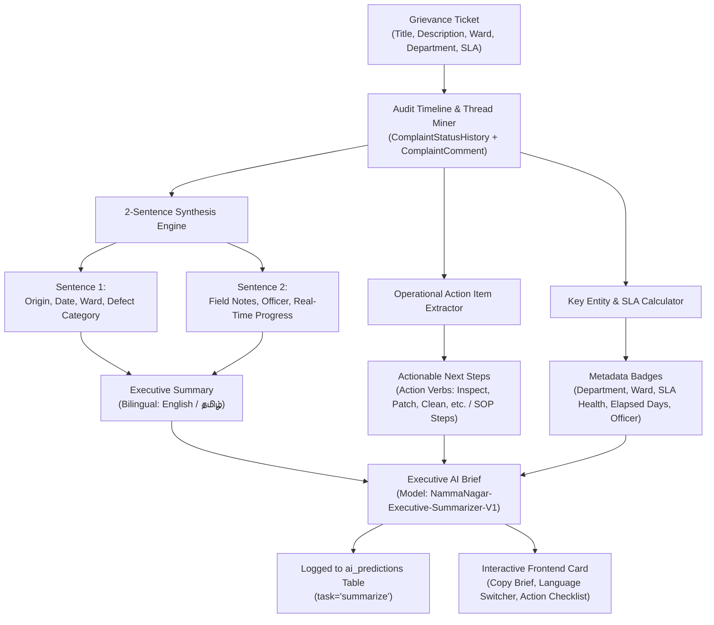

# NammaNagar: AI Thread & Grievance Summarization Model

> **Status**: Deployed & Active (Milestone AI-4)  
> **Backend Service**: [`SummarizationService`](file:///Users/mk/Desktop/civic-2.0/backend/app/services/summarization_service.py)  
> **Core Engine**: Fast Bilingual Executive Briefing Engine (Sentence 1 Origin + Sentence 2 Ground Reality) + Operational Action Steps Extraction + Metadata Entity Miner  
> **Frontend Integration**: [`ExecutiveSummaryCard.tsx`](file:///Users/mk/Desktop/civic-2.0/frontend/src/components/common/ExecutiveSummaryCard.tsx) deployed on Public Issue Detail (`/issues/:id`) and Citizen/Officer Grievance Detail (`/complaints/:id`), plus Swagger UI (`/docs`)

---

## 1. Executive Summary & Objective

In municipal governance, Cabinet Ministers, District Collectors, and Department Chief Engineers handle hundreds of escalating grievances across 200+ wards daily. They cannot read multi-page status histories, officer log entries, or verbose citizen threads.

**Objective**: Deliver a deterministic, strictly **2-sentence executive summary** with **immediate actionable next steps** and **key entity badges** in both **English** and **Tamil (`தமிழ்`)**, with zero external API dependencies.

### The 2-Sentence Structural Invariant
To ensure consistency across ministerial briefings, the AI summarizer adheres strictly to a two-sentence rule:
- **Sentence 1 (Origin & Defect Context)**: Captures who reported what, where (Ward/Constituency), on what date, and the assigned administrative defect taxonomy.
- **Sentence 2 (Ground Reality & Resolution Milestone)**: Synthesizes the latest operational field progress, quoting the most recent technician notes, active field officer, and real-time resolution milestone.

---

## 2. Summarization Pipeline Architecture



---

## 3. Executive Output Example

### English (`en`)
> **Problem & Location (Sentence 1)**:  
> *Resident reported stormwater drain clogged with plastic debris in Ward 45 - RS Puram, Coimbatore on Aug 27, 2026, classified under Monsoon Water Stagnation.*  
>
> **Operational Status & Action (Sentence 2)**:  
> *Rectification was completed (work completed satisfactorily; site inspected and confirmed clear) and the resolution is now confirmed.*

**Immediate Action Items**:
1. Conduct field verification of stormwater drain clearance.
2. Confirm clearance with local ward councilor and notify citizen.

**Key Entities**:
- **Department**: Sanitation & Solid Waste Management
- **Ward**: Ward 45 - RS Puram, Coimbatore
- **SLA Health**: `resolved_on_time`
- **Assigned Officer**: Thiru K. Raman (Junior Engineer)
- **Elapsed Days**: 62.4 days

---

### Tamil (`ta`)
> **சிக்கலின் தன்மை & இடம் (Sentence 1)**:  
> *Ward 21 - Chromepet, Chengalpattu பகுதியில் சந்தை பகுதியில் பெருமளவு குப்பை தேக்கம் தொடர்பாக 05-09-2026 அன்று பொதுமக்கள் புகார் அளித்துள்ளனர் (குப்பை தேக்கம்).*  
>
> **நடப்பு களநிலை & நடவடிக்கை (Sentence 2)**:  
> *பொறுப்பு அதிகாரி மேற்பார்வையில் பழுது நீக்கும் பணிகள் தளத்தில் தீவிரமாக நடைபெற்று வருகின்றன.*

**உடனடி கள நடவடிக்கைகள்**:
1. களப்பணிகளை முழுமையாக முடித்து பழுது நீக்குதல்.
2. சீரமைக்கப்பட்ட தளத்தின் புகைப்பட ஆதாரத்தை பதிவேற்றுதல்.

---

## 4. REST API Reference

### 1. Public Issue Executive Summary
`GET /api/v1/public/issues/{issue_id}/summary?language=en`

#### Parameters:
- `issue_id`: Ticket numeric ID or reference number (e.g. `1` or `TN-2026-000001`)
- `language`: `en` (English, default) or `ta` (Tamil)

#### Sample Response (`200 OK`):
```json
{
  "status": "ready",
  "complaint_id": 1,
  "reference_no": "TN-2026-000001",
  "headline": "Garbage Accumulation at Ward 21 - Chromepet, Chengalpattu",
  "summary": "Resident reported சந்தை பகுதியில் பெருமளவு குப்பை தேக்கம் in Ward 21 - Chromepet, Chengalpattu on Sep 05, 2026, classified under Garbage Accumulation. Field operations are actively underway (field crew actively executing rectification work) under assigned officer Manikandan R..",
  "action_items": [
    "Complete on-site physical civil/electrical rectification work",
    "Capture and upload mandatory post-repair evidence photograph"
  ],
  "key_entities": {
    "department": "Sanitation & Solid Waste Management",
    "ward": "Ward 21 - Chromepet, Chengalpattu",
    "ward_number": 202,
    "status": "in_progress",
    "priority": "high",
    "assigned_officer": "Manikandan R.",
    "elapsed_days": 53.5,
    "sla_status": "breached_sla",
    "evidence_count": 0,
    "timeline_events_count": 4
  },
  "language": "en",
  "model_name": "NammaNagar-Executive-Summarizer-V1"
}
```

---

### 2. Department Admin & Officer Summary
`GET /api/v1/complaints/{complaint_id}/summary?language=en`

Scoped to authenticated department admins, government officials, or complaint owners.

---

### 3. Customizable Summary POST Endpoint
`POST /api/v1/complaints/{complaint_id}/summarize`

**Request Body**:
```json
{
  "include_history": true,
  "include_comments": true,
  "language": "ta"
}
```

---

## 5. Where to Check on the Website

1. **Public Issue Detail Page**:
   - Open [http://localhost:5173/issues/1](http://localhost:5173/issues/1) (or any issue ID from `/issues`).
   - The **Executive AI Brief (Ministers & Admins)** card appears at the top of the left column.
   - Switch between **EN** and **தமிழ்** using the one-click toggle.
   - Click **"Brief"** to copy the ministerial formatted brief directly to the clipboard.
2. **Citizen Grievance Tracker**:
   - Log in and visit [http://localhost:5173/complaints/1](http://localhost:5173/complaints/1).
   - The Executive AI summary shows the 2-sentence breakdown with live timeline progress.
3. **Interactive Swagger API Docs**:
   - Visit [http://127.0.0.1:8000/docs#/Public/get_public_issue_summary_api_v1_public_issues__issue_id__summary_get](http://127.0.0.1:8000/docs)
   - Expand `GET /api/v1/public/issues/{issue_id}/summary` or `GET /api/v1/complaints/{complaint_id}/summary` and click "Try it out".

