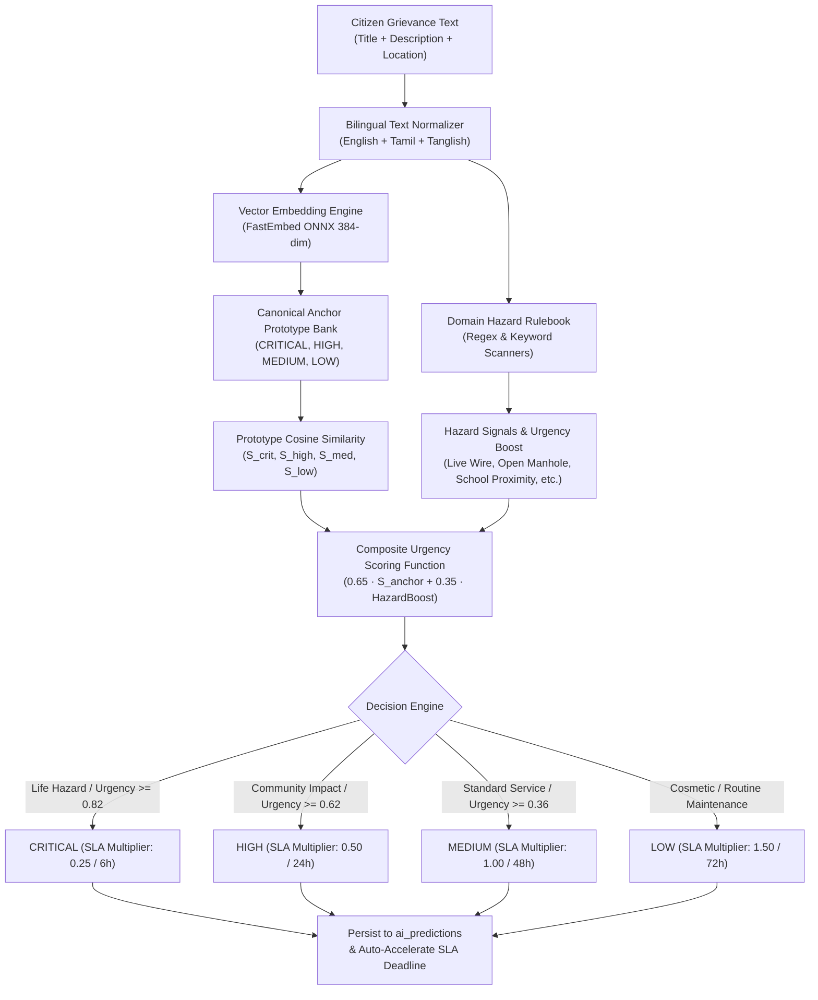

# NammaNagar: AI Priority & Severity Prediction Model

> **Status**: Deployed & Active (Milestone AI-2)  
> **Backend Service**: [`PriorityPredictionService`](file:///Users/mk/Desktop/civic-2.0/backend/app/services/priority_service.py)  
> **Model Provider**: FastEmbed ONNX Multilingual Embedding (`sentence-transformers/paraphrase-multilingual-MiniLM-L12-v2`) + Canonical Bilingual Anchor Bank + Domain Hazard Signal Rules  
> **Frontend Integration**: [`ReportPage.tsx`](file:///Users/mk/Desktop/civic-2.0/frontend/src/pages/public/ReportPage.tsx) (`/report`), Officer AI Insights (`/officer`), and Swagger UI (`/docs`)

---

## 1. Executive Summary

In public administration, triage latency can be life-critical. An open manhole during monsoon rains or a sparking live wire near a primary school cannot wait for the standard 48-hour municipal turnaround.

**NammaNagar AI Priority Prediction** evaluates citizen reports in real time as they are composed in English, Tamil (`தமிழ்`), or Tanglish. It automatically identifies life-safety risks, vulnerable zones (schools, hospitals, elderly homes), and public health hazards to:
1. Recommends the authoritative priority tier: **`CRITICAL`**, **`HIGH`**, **`MEDIUM`**, or **`LOW`**.
2. Automatically calculates an **Urgency Score** ($0.0 - 1.0$) and **Confidence Level**.
3. Accelerates statutory SLA deadlines (e.g., reducing turnaround from $48\text{h}$ down to $6\text{h}$ for critical hazards).
4. Persists inference audit logs to the `ai_predictions` table for government transparency and review.

---

## 2. Multi-Signal Hybrid Architecture



---

## 3. Priority Tiers & SLA Impact

| Priority Tier | Urgency Score Range | SLA Multiplier | Recommended Turnaround | Typical Triggers |
| :--- | :--- | :--- | :--- | :--- |
| **`CRITICAL`** | **`0.82 – 0.99`** | **`0.25`** | **$4 – 6\text{ hours}$** | Live dangling electric wire, transformer fire, uncovered manholes, toxic chemical in tap water, road sinkhole / bridge crack. |
| **`HIGH`** | **`0.62 – 0.81`** | **`0.50`** | **$24\text{ hours}$** | Complete water cutoff for 3+ days, monsoon flood water entering homes, major pothole on national highway, hospital ambulance route blocked. |
| **`MEDIUM`** | **`0.36 – 0.61`** | **`1.00`** | **$48\text{ hours}$** | Streetlight not glowing in residential lane, overflowing municipal bin, inner colony potholes, dead animal removal. |
| **`LOW`** | **`0.05 – 0.35`** | **`1.50`** | **$72\text{ hours}$** | Defaced wall posters, peeling paint on bus shelter, park bench loose plank, signboard spelling error. |

---

## 4. REST API Endpoints

### 1. `POST /api/v1/public/issues/predict-priority`
Public prediction seam used live by the report filing form.

**Request Body**:
```json
{
  "title": "Dangling high voltage wire near primary school gate",
  "description": "Wire sparking, children walking past, danger of electrocution",
  "location_text": "Anna Salai, Royapuram"
}
```

**Response (`200 OK`)**:
```json
{
  "recommended_priority": "CRITICAL",
  "urgency_score": 0.97,
  "confidence": 0.99,
  "hazard_signals": [
    "Live electric wire / electrocution hazard",
    "School zone / children proximity"
  ],
  "sla_multiplier": 0.25,
  "sla_recommended_hours": 6,
  "explanation": "Classified as CRITICAL due to imminent life-safety or public health hazard signals. Detected hazards: Live electric wire / electrocution hazard, School zone / children proximity."
}
```

---

### 2. `GET /api/v1/complaints/{id}/ai-insights`
Inspect stored or live-computed AI insights for any specific grievance.
- **Authentication**: Bearer Token (Officer, Admin, or Ticket Creator)
- **Response**: Full breakdown including current vs. recommended priority, urgency score, confidence, hazard signals, and SLA multiplier.

---

## 5. Where to Test on the Website

### Touchpoint A: Citizen Filing Form (`/report`)
1. Open [**http://localhost:5173/report**](http://localhost:5173/report)
2. In the **Headline / Brief Summary** field, type:
   - English: `Live electric wire sparking near primary school gate`
   - Tamil: `பள்ளி அருகே மின் கம்பி அறுந்து விழுந்து தீப்பொறி பறக்கிறது`
3. Click **"• Add more details — description, severity"**:
   - The **Severity Level** selector automatically switches to **`critical`**!
   - A purple/amber AI badge appears:  
     > **✨ AI Suggests: CRITICAL (97% urgency)**
   - **Detected Hazard Signals** display as pills:  
     `⚠️ Live electric wire / electrocution hazard`  
     `⚠️ School zone / children proximity`

### Touchpoint B: Interactive Swagger API Docs (`/docs`)
1. Navigate to [**http://127.0.0.1:8000/docs**](http://127.0.0.1:8000/docs)
2. Open `POST /api/v1/public/issues/predict-priority`
3. Click **Try it out**, paste the JSON payload, and execute to see real-time urgency and hazard detection.

### Touchpoint C: Automated Pytest Suite
Run the unit test suite:
```bash
PYTHONPATH=backend backend/venv/bin/pytest tests/test_priority_prediction.py -v
```

